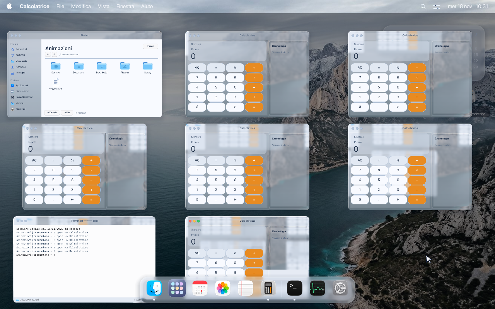

# Macroblocco 3 — Prestazioni, Grafica e Animazioni

**Completato per implementazione e collaudi locali host + QEMU.** Nessun avanzamento al macroblocco 4, incremento di versione o rilascio pubblico. GPU/HDMI fisici e Windows reale non certificati.

Riferimento esclusivo: punto 3 di `tinymacOS/docs/piano.pdf`, conservato byte per byte. Questa è una verifica dei risultati, non un nuovo piano.

## Interventi

- **Tempo reale delle animazioni:** i frame lenti non perdono più il tempo oltre 7/8 tick. Apertura, chiusura, contrazione, ripristino, zoom, Mission Control, transizioni dei contenuti, wallpaper e overlay avanzano sul tempo trascorso, limitato alla durata residua. La sfumatura di Mission Control dipende dal tempo, non dal numero di frame. Riduci movimento conserva gli endpoint immediati.
- **Mission Control:** riutilizzo della vera texture della finestra durante trasformazione/dim, anziché ricatturare vetro e contenuti per ogni fase. Aggiornamenti dei comandi applicativi, focus e dimensioni invalidano correttamente; il primo frame stabilizzato ricalcola il backdrop effettivo. Non sono miniature finte o schermate preregistrate.
- **Vetro e spostamento finestre:** fast path interno matematicamente equivalente al materiale originale. Dove copertura è piena e rifrazione/rim sono nulli, vengono evitati normali, divisioni e lookup inutili. Bordi, rifrazione, tinte, blur, Recovery opaca e fallback restano presenti. Il percorso è comune a finestre, trascinamento e pannelli.
- **Libreria app:** stesso vantaggio sul materiale; eliminati ridisegni da soli movimenti verticali del puntatore che non cambiano cella selezionata né luce. Cambiamento di cella o coordinata x mantiene l'aggiornamento reale, senza ridurre la precisione dell'illuminazione.

## Confronto ripetibile prima/dopo

Stesso host e QEMU/TCG, 2 vCPU, 768 MiB, 1280×800, input USB reali, **8 finestre**; build retail precedente e candidata, senza strumentazione nel sistema. Tre cicli per misura. Mediane del tempo fra input e geometria finale osservata nel framebuffer:

| Operazione | Prima | Dopo | Riduzione |
|---|---:|---:|---:|
| Mission Control, ingresso | 2.863 s | 0.351 s | 87.7% |
| Mission Control, uscita | 3.041 s | 0.636 s | 79.1% |
| Libreria app, ingresso | 0.440 s | 0.317 s | 27.9% |
| Libreria app, uscita | 0.314 s | 0.312 s | 0.6% |

CPU della Scrivania per ciclo ingresso+uscita, mediana dei tick realmente schedulati: Mission Control **899 → 157**; Libreria app **101 → 69**.

### Trascinamento

Il test continuo di 60 report torna alla geometria iniziale e lascia invariata la regione liberata. I tick CPU 211 → 216 **non dimostrano un miglioramento** in questo carico continuamente saturo.

Misura aggiuntiva a lavoro fisso: **24 spostamenti reali da ±10 px**, attendendo dopo ciascuno la corrispondenza esatta del semaforo attivo nel framebuffer. Latenza mediana **0.1657 → 0.1547 s**; somma delle 24 latenze **4.209 → 3.935 s**. Geometria finale ripristinata e nessuna scia nella zona liberata. Campioni integrali nelle due ricevute `drag-*.json`.

### Limiti delle misure

I tempi sono input-to-frame osservati, **non FPS/GPU fisici**. Il key press/release distanziato del runner introduce un pavimento di circa 0,29 s: i risultati vicini a 0,31 s non misurano animazioni con precisione sub-frame. Per i tempi viene confrontata una maschera opaca satura, esatta e senza tolleranza: non si pretende uguaglianza dell'intero vetro della build vecchia, il cui campionamento dipende dalle fasi animate. Il controllo di integrità del materiale è separato e bit-exact nei test host.

## Accettazione

- **PASS host normale + ASan/UBSan:** vero `motionstep` per tutte le trasformazioni, frame in ritardo, stallo lungo, endpoint e Riduci movimento; vera cache usata in produzione, 24 frame dim riutilizzati, invalidazioni per contenuti/focus/backdrop stabilizzato/spostamento/resize.
- **PASS vetro:** 88 confronti dell'intero framebuffer, pixel per pixel, fra percorso lento e ottimizzato, in entrambe le configurazioni; temi chiaro/scuro, raggi 0–60, pannelli grandi/piccoli e clipping ai limiti. Benchmark solo host nel log, non spacciato per prestazione GPU.
- **PASS foundation e M0 workspace:** font/asset/vendor/USB protetti, testo/sicurezza, ABI/overlay, versione invariata e regressioni host incluse nel runner.
- **PASS build completa live + Recovery retail**, guard TMCFS2-only e USB canonico inclusi.
- **PASS guest prima/dopo:** Mission Control e Libreria, 8 finestre, input Terminale ancora reattivo; trascinamento continuo e a checkpoint.
- **PASS Dock:** tre cicli Mission Control in basso e tre a sinistra, ripristino esatto di tutti i pixel Dock+ombre/backdrop, **zero pixel diversi e zero aloni**. Glifo Apple allineato al testo File entro 1 px.
- **PASS 18 finestre:** 16 Calcolatrici + Finder/Terminale, pubblicazioni identiche deduplicate, puntatore verificato contro lo sprite distribuito, CPU idle osservata e Terminale reattivo. Ricevuta `many-windows-candidate.json`.

### Attendibilità dei runner

Gli osservatori QMP ora compilano la struttura Process/Win reale anziché usare offset storici: Process 9592 byte, Win all'offset 2352. Solo letture, nessuna scrittura in memoria guest.

Il test Dock originale catturava una luce ancora associata al puntatore di boot: sia ISO precedente sia candidata mostravano gli stessi 4501 pixel interni diversi (delta massimo 31), ma zero aloni. È stato riprodotto differenzialmente; il golden ora viene acquisito dopo un ciclo di assestamento alla stessa posizione del puntatore. Le sei verifiche finali mantengono l'uguaglianza esatta, senza allargare tolleranze. La topologia finale ha mouse e tastiera USB reali; un tentativo precedente senza tastiera supportata non è accettazione.

## Preservazione e provenienza

Solo sette input di produzione del desktop differiscono dal checkpoint precedente (inclusi due nuovi header); **1077 input** congelati verificati invariati dopo build e guest. Kernel normale, Recovery e le applicazioni elencate in `artifacts-final.json` sono byte-identici alla build del blocco 2. Nessuna modifica a filesystem, driver storage, Installer, dati utente, snapshot, font o asset protetti.

ISO candidata: `97ba0570fe036e0615c12941a2f5af3a16ab19940947f13d6893c6d1024394d6`.

Le ricevute e i log compressi qui conservati identificano gli artefatti effettivamente provati. L'ISO resta nella directory esterna di build per non superare il budget del workspace. Il bundle Git persistente conserva sorgenti, prove e immagini essenziali, non l'ISO. Nessuna certificazione hardware/Windows, nessuna release o avanzamento al blocco 4.

