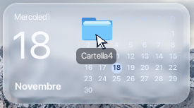
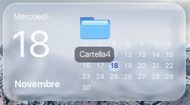
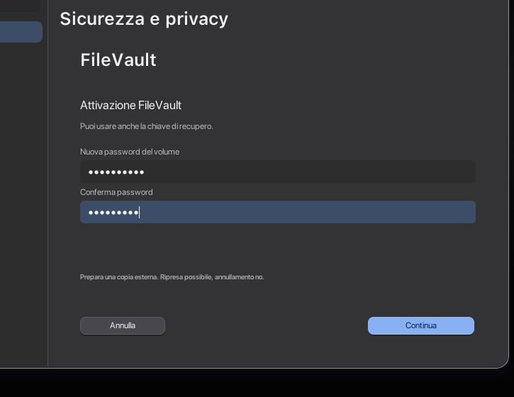

# Macroblocco 4 — Desktop, Input e Scorciatoie

**Completato per implementazione e collaudi locali host + QEMU.** Nessun avanzamento al macroblocco 5, incremento di versione o rilascio pubblico. Hardware fisico, touchscreen reale e Windows reale non certificati.

Riferimento esclusivo: punto 4 di `tinymacOS/docs/piano.pdf`, conservato byte per byte, SHA-256 `fe66291ae6368af7abbec48877f4086ed4c76180469c2e87873abd6aa175a86f`. Questa è una verifica dei risultati, non un piano sostitutivo.

## Interventi

### Tastiera italiana Windows

**Win = Command, Ctrl = Control, Alt sinistro = Option; AltGr resta distinto.** La separazione vale nel dispatcher e nelle applicazioni: Ctrl non è più il sostituto indiscriminato di Command. Nel Terminale **Ctrl+C interrompe**, mentre **Win+C/V** copia/incolla.

Le scorciatoie comprendono Win+Spazio per Cerca, Ctrl+↑ per Mission Control, Win+Maiusc+A per Libreria, Win+W/M/Q per chiusura/contrazione, Win+Ctrl+Q per blocco. Finder usa Win+N, Win+Maiusc+N, Win+↑/↓, Win+O, Invio per rinominare e Win+Backspace per richiedere l’eliminazione; rimossi i vecchi alias di navigazione/eliminazione non modificati. La [guida completa](../../../tinymacOS/docs/SCORCIATOIE.md) documenta anche i limiti del modello delle finestre.

**Recovery: Win+R al logo del loader UEFI.** R da solo e F12 non aprono più il Recupero; Ctrl+R non è Command+R. Il loader legge i modificatori validi del protocollo Text Input Ex. Se il firmware non li espone, resta la voce esplicita Recovery in OpenCore, non un fallback ambiguo sul solo R. In Recovery Ctrl+F2 apre il menu Utility.

Il driver canonico cambia in **una sola assegnazione**: i modificatori già interpretati vengono conservati nel campo `Event.d` esistente. Struttura ABI, enumerazioni, trasporto USB, parser, repeat e tabelle non sono riscritti. Il test rimuove quell’unica assegnazione e ricostruisce esattamente l’hash protetto precedente: la modifica M0 è un’eccezione specifica tracciata, non uno sblocco generale dei driver.

### Scrivania

- **Tasto destro → Nuova cartella:** finestra diretta della Scrivania, senza aprire Finder. Nome modificabile con clic, conferma e annullamento; collisioni e nomi non validi non sovrascrivono dati.
- **Posizioni libere:** icone spostabili a coordinate arbitrarie, senza scatto obbligatorio a una griglia. Disegno e hit-test condividono le stesse posizioni; le icone sono sopra il widget ma sotto le finestre.
- **Persistenza per utente:** `~/Library/Preferences/Desktop.layout`, con intestazione/versione, associazione identità/nome, I/O a blocchi e controllo dei limiti. Preferenze incomplete/non valide vengono ignorate; le posizioni vengono limitate allo schermo.
- **Drop reali:** riposizionamento sulla Scrivania, trasferimenti fra Scrivania e Finder, rilascio nel Terminale come solo percorso fra virgolette. Il rilascio di un file non lo esegue.

### Cursore e inserimento

Clic/tocco assoluto posiziona l’inserimento secondo il testo effettivamente visualizzato. Gestione per caratteri UTF-8, non per singoli byte; viewport coerente col disegno, campi mascherati e ripristino del lampeggio dopo input.

Copertura: login/configurazione iniziale e relativo codice, Cerca e Nuova cartella della Scrivania, dialoghi Finder, pannelli Apri/Salva e relativa Nuova cartella, installer, FileVault, ricerca/passphrase Impostazioni, dimensione/nome/percorso di esportazione in Utility Disco, promemoria Calendario e prompt del Terminale. TextEdit, Note e Memo conservano i cursori esistenti e le relative regressioni host. Le stesse applicazioni di manutenzione funzionano in Recovery. I prompt del Terminale **senza eco restano senza eco**: nessuna rivelazione della lunghezza delle password.

## Accettazione host

- **PASS normale + ASan/UBSan:** input USB reale del driver, Win/Ctrl/Maiusc/AltGr italiano e criteri UEFI Win+R.
- **PASS vero codice della shell:** creazione cartella con zero avvii Finder, collisione/annullamento/nomi non validi, coordinate esatte non allineate, salvataggio/ricaricamento, clipping e preferenze malformate; Cerca/Libreria/Mission Control e limiti dei cursori UTF-8.
- **PASS sette famiglie di handler applicativi reali, normale + ASan/UBSan:** login, installer, FileVault, pannello Apri/Salva, Utility Disco, Impostazioni e ciclo eventi Calendario. Inserimento nel mezzo mediante clic, campi mascherati, navigazione/cancellazione UTF-8 e selezione per sostituzione dove applicabile. Nessuna operazione distruttiva del backend durante questi test.
- **PASS regressioni Terminale/caret:** separazione copia/interruzione, selezione output in sola lettura, incolla non eseguibile, quoting dei drop, no-echo, lampeggio/soppressione dietro overlay e ripristino esatto dello sfondo; Note/Memo e round-trip TextEdit.
- **PASS foundation completa e M0 workspace:** 568 input protetti secondo il contratto aggiornato e audit dell’unico delta nel driver; inventario statico 149 file / 2474 stringhe, 29 sorgenti overlay e 12 header ABI sincronizzati. L’inventario statico non sostituisce l’accettazione visiva.
- **PASS build retail completa**, UEFI e Recovery compresi; guard filesystem TMCFS2-only e USB canonico attivi; `git diff --check` pulito.

## Accettazione QEMU sulla stessa ISO finale

QEMU/TCG, 2 vCPU, 768 MiB, 1280×800, tastiera USB e tablet assoluto USB. Input tramite eventi reali QMP; confronto del framebuffer e sole letture della tabella processi per contare le finestre. **Nessuna scrittura in memoria guest**, volume nativo preformattato dall’host o servizio diagnostico aggiunto al sistema.

1. Setup: clic nel nome proporzionale trasforma `Dsk4` in `Desk4`; account creato e autenticato. Win+W chiude Finder.
2. Tasto destro: finestra Nuova cartella con **zero finestre client**; clic nel nome e inserimento nel mezzo producono `Cartella4`, sempre senza Finder.
3. Spostamento icona: delta esatto **(+147, −193)**; successivo posizionamento libero sul widget. Etichetta finale a **(1100, 135)** nel framebuffer.
4. F2/F11 non lanciano applicazioni. Win+Spazio avvia Terminale; copia/incolla con Win e interruzione con Ctrl restano distinti. Il clic nel prompt inserisce il carattere nella colonna attesa e produce `CLICK4`.
5. Drop Scrivania → Terminale: percorso quotato negli appunti, senza esecuzione. Il percorso usa l’alias di sistema supportato `/Users/User`, risolto all’account attivo.
6. Drop Scrivania → Finder e ritorno a un punto arbitrario della Scrivania: **vero spostamento**, contenuto `PAYLOAD4` letto dal sistema dopo entrambi i trasferimenti.
7. Esercitate le nuove combinazioni globali, il blocco e il successivo sblocco della sessione.
8. Installer: cursori vuoti/mascherati, conferma e inserimento con clic verificati nel framebuffer. Configurazione cifrata annullata prima di scrivere il disco.
9. **Installazione GUI reale** su NVMe virtuale vuoto: TMCFS2, account/file/preferenze importati; il programma di installazione verifica OpenCore come avvio principale.
10. **Avvio nativo a freddo senza ISO:** autenticazione dell’account importato, payload conservato e posizione dell’etichetta ancora esattamente **(1100, 135)**.
11. **Recovery interna senza ISO**, selezionata con Win+R: Ctrl+F2/menu Utility, inserimento tramite clic nel Terminale (`CLICKREC4`), cursori e clic nei campi password/conferma FileVault. Attivazione annullata.
12. Tre avvii separati dalla ISO finale: **Win+R → Recovery; F12 → setup normale; R → setup normale**.

Ricevute: `guest.json`, `boot-keys.json`, `recovery-final.json`; log compressi accanto al rapporto. La ripetizione Recovery aggiuntiva acquisisce anche i campi attivi prima dell’annullamento.

## Attendibilità e limiti

Il runner è stato corretto senza allargare tolleranze: distingue il logo del loader da quello precedente, sposta il puntatore fuori dal cursore prima del confronto esatto, riconosce l’inchiostro del cursore nei due frame di lampeggio anziché scambiare lo sfondo per un cursore e usa etichette/alias realmente distribuiti. Un’esecuzione foundation è stata ripetuta integralmente dopo l’aggiunta di test al runner mentre la shell lo stava leggendo. I risultati accettati sono quelli finali conservati, non i tentativi incompleti.

I cursori sono controllati come rettangoli solidi esatti da 1–2 × 15–17 pixel. Le coordinate delle icone sono confrontate esattamente, non con una tolleranza visiva. Le immagini qui sotto sono **ritagli rettangolari senza ricampionamento o ritocco**; `evidence/receipts.json` conserva coordinate e hash delle schermate originali esterne e dei ritagli persistiti.

Non si dichiara un test su ogni tastiera/firmware/touchscreen fisico né una nuova misura di prestazioni GPU. La matrice guest è mirata; la copertura degli altri campi comprende codice reale host e compilazione. Nessun avanzamento ai blocchi 5–6.

## Preservazione e ripetibilità

**1079 input di produzione verificati**, 24 percorsi diversi dal checkpoint del blocco 3. I 976 input sorgente/asset congelati sono invariati durante il collaudo; i restanti 103 input/tool del manifest sono invariati rispetto al checkpoint precedente. Nessuna modifica ai sorgenti filesystem/storage, ai font, agli asset o ai vendor; resta **TMCFS2 come unico filesystem nativo**, senza ripristinare driver, formattatori o fallback legacy. Le modifiche a Installer/Utility Disco riguardano i campi, non algoritmi di partizionamento o copia. Nessun cambio alla versione pubblica.

ISO finale: **`39b040509a63a4cfa4ca3d9136744fc430dcfc432b8226e46c2b8d4c6752d413`**, 227805184 byte. Hash di loader, kernel e applicazioni in `artifacts-final.json`. ISO e dischi QEMU restano esterni al workspace per rispettarne il limite; sorgenti, ricevute e prove essenziali sono persistenti.

Comandi principali, dalla radice del workspace dopo la build:

```sh
bash tinymacOS/tests/test-10.3-foundation.sh
python3 tinymacOS/tests/test-m0.py --workspace
TMC_TEST_ISO=/var/tmp/tmc-block4-final/tmc-block4-retail.iso \
TMC_BUILD=/var/tmp/tmc-block4-final TMC_UI_RESULT=/var/tmp/block4-guest.json \
TMC_QA_KEY_GAP=.22 TMC_QA_KEY_HOLD=.07 \
python3 tinymacOS/tests/desktop4_acceptance_guest.py
TMC_TEST_ISO=/var/tmp/tmc-block4-final/tmc-block4-retail.iso \
TMC_UI_RESULT=/var/tmp/block4-boot.json \
python3 tinymacOS/tests/desktop4_boot_guest.py
```

### Icona libera sopra il widget, sessione live



### Stessa posizione dopo installazione e avvio senza ISO



### Campi FileVault nella Recovery interna


