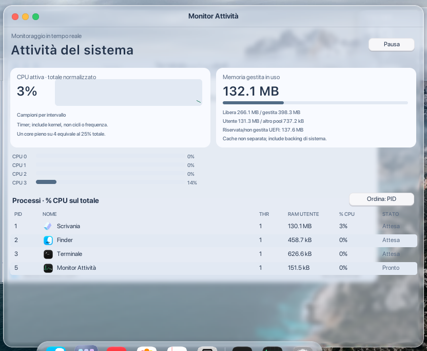
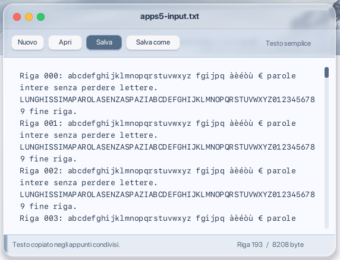
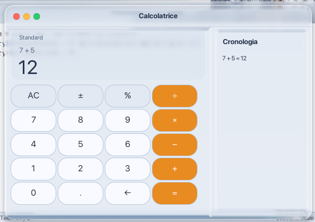

# Macroblocco 5 — Applicazioni di Sistema

**Completato: implementazione e collaudo locale.** Ambito: Gestione Attività, TextEdit e cronologia della Calcolatrice, come nelle pagine 2–3 di `tinymacOS/docs/piano.pdf`. Nessun lavoro al blocco 6, cambio di versione pubblica o nuova release.

## Risultato

| Applicazione | Intervento | Verifica |
|---|---|---|
| Monitor Attività | Conservati i contatori reali del kernel per CPU e RAM; campioni iniziali, invalidi o mancanti mostrati come indisponibili, non come uno 0% inventato | Codice reale host normale e ASan/UBSan; carichi reali su 4 core, allocazioni/commit e avvio nativo |
| TextEdit | A capo preferenziale tra parole, fallback tra caratteri UTF-8 per parole lunghe; posizione corretta del cursore sul bordo destro di una riga spezzata | Test di confine, modifica e salvataggio; confronto esatto dei pixel con il font distribuito |
| TextEdit | Barra interna visibile, rotella indipendente dal cursore, clic sulla traccia per pagina e trascinamento del cursore della barra | Input USB reale, ridimensionamento e verifica di tutti i byte salvati |
| Calcolatrice | Vetro della cronologia spostato di **8 pixel a destra**, mantenendo il margine destro di 6 pixel; testo spostato insieme al pannello | Geometria su cinque larghezze, aritmetica/storico host e risultato nel guest |

### CPU e RAM: misure, non stime

L’audit ha confermato che il blocco 3 aveva già introdotto i produttori reali: campioni dello scheduler per core/processo e pagine effettivamente allocate/residenti. Non sono stati sostituiti con percentuali simulate. Il blocco 5 rende esplicita la validità delle letture: primo intervallo, ripresa dalla pausa, reset, processo nuovo e guasti di lettura non vengono confusi con attività nulla. Il vero **0% misurato resta 0%**. I dati RAM incoerenti vengono indicati come indisponibili.

La CPU totale è normalizzata sul numero di core: un core pieno su quattro vale circa il 25%. Sono campioni timer, **non cicli CPU, frequenza o consumo elettrico**. La RAM gestita in uso è `totale pool − libera`; la RAM utente, il restante pool e la memoria riservata/non gestita UEFI restano distinti. La RAM per processo è il backing utente residente reale. La cache non viene attribuita separatamente.

Misure della nuova ISO, guest QEMU APIC a quattro core; valori grezzi conservati in `telemetry-raw.jsonl`:

| Carico reale | CPU totale | CPU del processo di prova |
|---|---:|---:|
| Inattività | 0,32% | 0,16% |
| Un worker | 25,19% | 24,81% |
| Worker multipli | 86,70% | 85,81% |
| Sleep | 0,16% | 0,00% |

L’allocazione di **8.388.608 byte** e il commit di **4.194.304 byte** incrementano esattamente sia il backing utente globale sia il residente del processo. Free/release riportano entrambi ai valori precedenti; resta soltanto il limitato overhead delle tabelle pagine vuote fino alla terminazione, non una perdita di 12 MiB. Il report di 13 record è stato scritto dal guest, installato tramite la GUI e riletto dopo avvio nativo senza ISO.

### TextEdit: nessuna lettera persa e scorrimento reale

Il font mono distribuito è stato controllato: le celle sono di 8 pixel e l’inchiostro dei glifi resta nella cella. **Non si attribuisce quindi il difetto a un overflow del font non dimostrato.** È stato corretto il problema verificabile del confine di riga: End/clic sul margine destro non devono arretrare di un carattere per restare sulla riga. Ora lo stesso indice del documento può rappresentare correttamente il bordo finale della riga precedente, senza sottrarre né omettere lettere.

L’impaginazione conserva tutti i byte, spazi compresi, senza inserire a capo nel file. Preferisce i confini tra parole e spezza le parole troppo lunghe soltanto tra caratteri UTF-8. I file contenenti NUL incorporati vengono rifiutati come non testuali, senza sostituire il documento aperto.

La rotella non sposta il punto di inserimento; nemmeno Copia o un ridisegno riportano forzatamente il viewport al cursore. La traccia scorre per pagina e il thumb raggiunge l’ultima riga. La Scrivania inoltra a TextEdit gli eventi di trascinamento già usati dal Terminale, senza cambiare ABI o scorciatoie.

Prove:

- **16 combinazioni** di larghezza/altezza nei nuovi test host: word wrap, UTF-8, End/clic, modifiche, rotella, traccia, thumb, resize, conservazione del viewport e byte salvati, normali e ASan/UBSan.
- Regressioni esistenti: **27 combinazioni di frame** fino a 1278×1024, senza superare il budget invariato di 144 comandi Draw; round-trip esatti di **144.000 e 141.735 byte UTF-8** con/senza newline.
- Guest nativo: **6 frame e 1.381.760 pixel** confrontati esattamente con la rasterizzazione di riferimento del font TFN2 distribuito. Coperti viewport iniziale, rotella, Copia, pagina, trascinamento fino al fondo e finestra più stretta/bassa. Nessuna tolleranza introdotta sui pixel delle lettere.
- Dopo modifica, ripristino, salvataggio e spegnimento, estrazione **in sola lettura**: tutti gli **8.208 byte** del documento coincidono con l’input deterministico. SHA-256: `33ce500099ee25cc41381a7a575157ac8cc6692e1d38f0090447561d665e2bac`.

Il documento lungo è una **fixture di solo testo preparata offline dopo l’installazione GUI reale**, non una prova di creazione massiva nel guest. Nessun account, file di sistema o contatore è stato iniettato. Apertura, modifica, scorrimento e salvataggio sono operazioni del sistema avviato.

## Build e regressioni

- Build retail completa: **PASS**.
- `test-10.3-foundation.sh`, inclusi i nuovi test delle tre applicazioni, contatori/allocatore reali, desktop/campi/scorciatoie del blocco 4: **PASS normale e ASan/UBSan** per le suite previste.
- `test-m0.py --workspace`, controllo inventario stringhe, font/asset/vendor bloccati e rimozione del filesystem legacy: **PASS**.
- Installazione GUI fresca, avvio nativo senza ISO e Monitor funzionante: **PASS**.
- Stessa ISO, selezione firmware: **Win+R entra in Recovery; R e F12 non la attivano: PASS**.
- `git diff --check`: **PASS**.

Verificati **1079 hash di input di produzione**. Solo quattro percorsi differiscono dal checkpoint del blocco 4: `desktop/main.c` e le tre applicazioni. Nessuna modifica ai sorgenti filesystem/storage, al renderer, ai font, agli asset, ai vendor o al codice delle scorciatoie. Kernel normale/Recovery, Finder e Terminale sono anche **binariamente identici** al blocco 4. TMCFS2 resta l’unico filesystem nativo; nessun ripristino di driver, formattatori, migrazione o fallback legacy.

ISO collaudata: `/var/tmp/tmc-block5/tmc-block5-retail.iso`
SHA-256: **`dd4dc2883467631a4c1864507582bb44efb86e0c567b0b5a0361678699deb177`**.

Hash e dimensioni degli artefatti in `artifacts-final.json`; input in `production-inputs-final.json.gz`. ISO/dischi sono esterni al workspace; sorgenti, ricevute, log compressi e immagini essenziali sono persistenti.

## Attendibilità e limiti

Due tentativi del runner grafico sono stati corretti: il primo non prevedeva il cursore lampeggiante sull’ultima riga vuota; il secondo attendeva erroneamente “Pronto” anziché il messaggio reale “Salvato su disco”. Il confronto finale accetta soltanto le due rasterizzazioni fisicamente valide, con o senza **l’esatto rettangolo del cursore 2×16** alla posizione prevista: nessuna maschera sulle lettere, ritocco o tolleranza allargata. L’intero collaudo grafico è stato ripetuto e concluso dopo le correzioni, senza cambiare l’ISO. Anche i log dei tentativi sono conservati.

Le tre immagini sotto sono **ritagli rettangolari senza ricampionamento o ritocco** di schermate vere; coordinate e hash originali/ritagli sono in `evidence/receipts.json`.

Non si dichiara una certificazione hardware, Windows, touchscreen, una nuova misura di prestazioni GPU o una ripetizione integrale di ogni matrice storica dei filesystem. La nuova prova telemetrica guest è a quattro core APIC; le altre configurazioni storiche non sono presentate come rieseguite qui. Nessun avanzamento al blocco 6.

## Ripetibilità

```sh
bash tinymacOS/tests/test-apps5.sh
bash tinymacOS/tests/test-10.3-foundation.sh
python3 tinymacOS/tests/test-m0.py --workspace
TMC_STAGE_ISO=/var/tmp/tmc-block5/tmc-block5-retail.iso \
TMC_QA_DIR=/var/tmp/tmc-block5-qa TMC_M3_CPUS=4 \
TMC_QA_KEY_GAP=.22 TMC_QA_KEY_HOLD=.07 \
python3 tinymacOS/tests/apps5_telemetry_guest.py
TMC_QA_DIR=/var/tmp/tmc-block5-qa \
TMC_QA_KEY_GAP=.22 TMC_QA_KEY_HOLD=.07 \
python3 tinymacOS/tests/apps5_visual_guest.py
```

Il secondo runner usa il disco temporaneo creato e installato dal primo. La prima esecuzione prepara il documento; `TMC_APPS5_FIXTURE_PREPARED=1` consente di ripetere il test su quello stesso disco, verificando comunque l’input contro il contenuto deterministico atteso.

### Monitor dopo avvio nativo



### TextEdit ridimensionato: a capo e barra interna



### Cronologia della Calcolatrice


