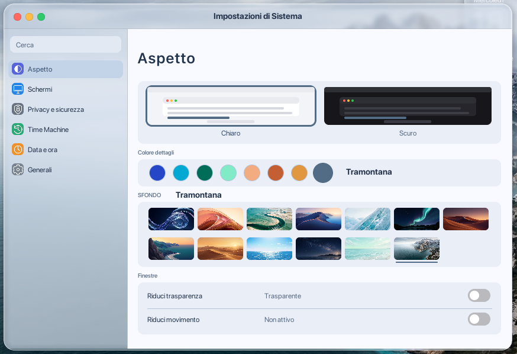
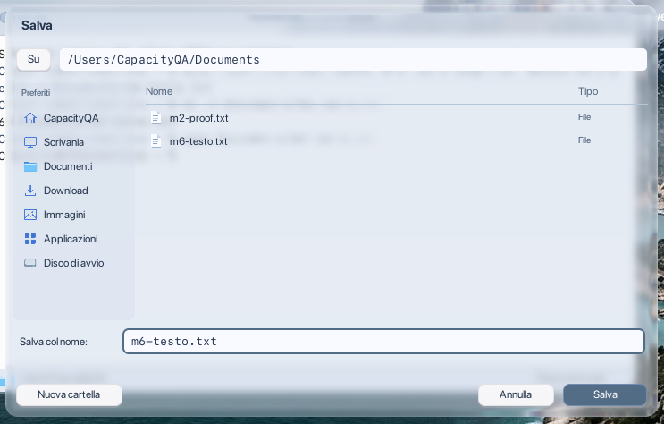
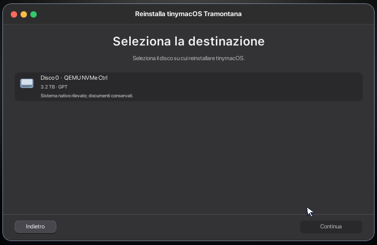
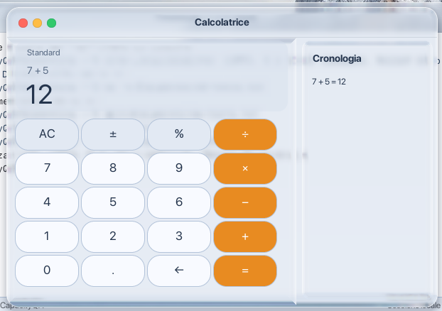

# Macroblocco 6 — Localizzazione, Testi e Unità di Misura

**Implementazione e collaudo locale completati.** Ambito delle pagine 2–3 di `tinymacOS/docs/piano.pdf`: testi nativi in app, setup e Recovery; terminologia italiana coerente con macOS dove applicabile; unità MB/GB/TB e valori numerici corretti. Nessun cambio di versione pubblica, release o certificazione hardware.

## Risultato

- **Testi più essenziali:** tolte spiegazioni duplicate dell’account persistente, del Dock e dell’orologio, lo stato “Pronto” privo di informazioni e istruzioni ridondanti nelle cartelle vuote. Errori, operazioni in corso e avvisi necessari restano visibili.
- **Terminologia uniforme:** Impostazioni di Sistema, Schermi, Privacy e sicurezza, Riduci trasparenza, Riduci movimento, Monitoraggio Attività, Memoria utilizzata, S.O.S., Vista rapida, Apri/Salva, Salva col nome, Riduci a icona, Blocca schermo. Rivisti anche menu, ricerca, libreria Applicazioni e conferme di spegnimento/riavvio.
- **Setup:** “Crea un account computer” e “Nome account”. Il nome continua a identificare realmente anche la cartella utente, senza introdurre un finto campo “Nome completo”. Resta l’avviso sulla sessione temporanea e il requisito minimo della password.
- **Metadati delle app:** `CFBundleDisplayName` italiano nei volumi live, disco e Recovery. Verificati **31 plist effettivamente costruiti** (14/13/4). Cartelle `.app`, eseguibili, identificatori e versione restano stabili.
- **Dimensioni coerenti:** Vista rapida, informazioni del Finder e stato di TextEdit usano il formatter SI comune, già usato da Monitor, Installer, Utility Disco, Impostazioni e Time Machine. Corretti gli ultimi due messaggi di limite ancora espressi in TiB.

Il registro `tinymacOS/docs/audit-10.3/localization-6-changes.json` conserva **112 voci di revisione**: comprende sostituzioni, rimozioni e aggiustamenti di layout, non significa “112 stringhe eliminate”. L’inventario finale comprende **149 file e 2473 letterali**, rispetto ai 2482 del blocco 5. È un inventario statico, non la prova che ogni letterale sia visibile.

## Unità: non un semplice cambio di suffisso

Il formatter comune usa base 1000 e seleziona automaticamente B/kB/MB/GB/TB/PB/EB; oltre B mostra una cifra decimale troncata. Il separatore dell’output comune resta il punto. Sono coperti soglie, valori immediatamente inferiori, interi a 64 bit, capacità dei buffer e suffissi senza duplicazioni.

| Byte reali | Visualizzazione |
|---:|---:|
| 999.999.999 | 999.9 MB |
| 1.000.000.000 | 1.0 GB |
| 1.000.000.000.000 | 1.0 TB |
| 3.298.534.883.328, disco virtuale provato | 3.2 TB |
| 2.748.779.069.440, spazio non allocato selezionato | 2.7 TB |

I limiti del backend **non sono cambiati**. I messaggi ora riportano l’equivalente SI esatto: **17.592186044416 TB** per la capacità supportata e **2.19902325504 TB** per il limite di ridimensionamento FAT32/NTFS. Non sono stati rinominati erroneamente “16 TB” e “2 TB”.

Conteggi di `wc -c`, offset dell’ispettore, LBA, hash e JSON diagnostici rimangono esatti in byte/settori. I commenti tecnici possono continuare a descrivere pagine/allineamenti binari reali. Il guardiano statico rifiuta invece MiB/GiB/TiB/KiB nelle stringhe di produzione, con test negativi che verificano il rifiuto.

## Funzioni e sicurezza preservate

L’adozione dei termini di macOS non trasforma tinymacOS in macOS e non introduce servizi o compatibilità inesistenti:

- Recovery conserva **“Ripristina da una copia locale”**. Gli snapshot sullo stesso disco non sono presentati come supporto a backup Time Machine esterni; resta l’avviso che non proteggono dal guasto del disco.
- Conservati avvisi di perdita dati, irreversibilità, conferma MBR, interruzione della cifratura, chiavi/password, errori FileVault e documenti non salvati. Il controllo M0 rifiuta anche la rimozione intenzionale di un avviso distruttivo.
- CPU e RAM restano misurate dai contatori del kernel. Le etichette continuano a precisare campioni timer, normalizzazione sui core e cache non conteggiata separatamente.
- **TMCFS2 resta l’unico filesystem nativo.** Nessun driver, formatter, migrazione o fallback legacy è stato ripristinato. Le stringhe che riconoscono un vecchio volume come non supportato restano necessarie.
- Nessun cambio al browser, ai font, agli asset, ai vendor o alla versione pubblica. Non sono tradotti percorsi, nomi dei comandi e formati macchina.

Su **8 sorgenti** selezionati — ABI, scanner/editor partizioni, shell, controllo, Recovery, Installer e Utility Disco — un nuovo controllo verifica l’identità del codice fuori dai letterali/commenti rispetto al blocco 5. Gli interventi in questi file sono testuali: non alterano algoritmi, ID o geometria. Altri aggiustamenti riguardano il rendering delle dimensioni, la rimozione di draw inutili e lo spazio per etichette più lunghe.

## Prove eseguite

| Verifica | Esito |
|---|---|
| Build retail completa | **PASS** |
| Foundation, incluse nuove prove di localizzazione e suite dei blocchi 4–5 | **PASS**, suite normali e ASan/UBSan previste |
| Vista rapida host reale: kB/MB/GB/TB/EB, soglie, sola lettura e contenuto invariato | **PASS normale + ASan/UBSan** |
| Formatter, ABI/algoritmi e assenza di etichette binarie UI | **PASS** |
| Plist/eseguibili nei tre volumi realmente costruiti e checksum dei payload | **PASS**, 31 app |
| Setup, impostazioni, Monitor e Applicazioni nel guest con input USB | **PASS** |
| Disco virtuale 3.2 TB, settori nativi da 4096 byte, gap reale da 2.7 TB | **PASS** |
| Installazione GUI, OpenCore primo in NVRAM prima dell’avvio nativo | **PASS** |
| Avvio nativo senza ISO: account/file importati e capacità coerenti | **PASS** |
| Recovery interna senza ISO: Installer, Utility Disco e Terminale concordano sulle capacità | **PASS** |
| Contenuto delle partizioni estranee al gap | **PASS**, verifica in sola lettura di tutti i settori allocati e delle regioni sparse zero |
| TextEdit Apri/Salva con nome e annullamento; Vista rapida e file UTF-8 nativo | **PASS** |
| Calcolatrice 7 + 5 = 12, cronologia e distanza del vetro | **PASS**; eseguibile binariamente identico al blocco 5 |
| Dodici famiglie host M2 correnti, in due tranche | **PASS**, normali/sanitizzate previste e controlli indipendenti FAT32 |
| M0 workspace, asset/font/vendor bloccati, inventario stringhe e rimozione legacy | **PASS** |

Le regressioni includono anche il round-trip TextEdit di documenti UTF-8 da 144.000 e 141.735 byte, i contatori reali di scheduler/allocatore, campi/cursori e scorciatoie Command/Control. La nuova matrice guest non viene presentata come una ripetizione di tutte le configurazioni storiche o di ogni schermata possibile.

### Correzioni dei runner, senza nascondere tentativi incompleti

Il primo test host del Monitor attendeva una vecchia etichetta: l’asserzione è stata aggiornata al testo nuovo, mantenendo identici i controlli sui dati. La prima esecuzione grafica non riconosceva l’intero titolo del setup su sfondo traslucido; il controllo finale riconosce i gruppi di parole nella posizione/font previsti, mantenendo la soglia originale del driver, senza abbassarla. Il guest completo è stato rieseguito con successo sulla stessa ISO.

Il wrapper M2 conteneva ancora `test-native-resize.sh`, eliminato con il vecchio filesystem. Le prime sette suite correnti erano passate prima di raggiungere quel riferimento inesistente. È stata rimossa **solo la voce obsoleta**, non ripristinato il backend; poi sono state eseguite le cinque suite TMCFS2/NVMe rimanenti sugli stessi input di produzione. I due log sono conservati: **non si dichiara un’unica esecuzione ininterrotta del wrapper finale**.

## Artefatti e ripetibilità

ISO collaudata: `/var/tmp/tmc-block6/tmc-block6-retail.iso`

SHA-256: **`daf1ebc3e704089236a0bb56067a8fcf91d40554badb048b6fae2b7008e1646c`**.

Verificati **1079 hash di input di produzione**, con 18 percorsi cambiati dal blocco 5. Solo due messaggi sono cambiati nei backend storage; i relativi algoritmi risultano identici fuori dai letterali. Hash/dimensioni dei binari e dei test in `artifacts-final.json`; input in `production-inputs-final.json`. ISO e dischi restano esterni al workspace, mentre sorgenti, ricevute, log e immagini essenziali sono persistenti.

```sh
bash tinymacOS/tests/test-localization6.sh
bash tinymacOS/tests/test-10.3-foundation.sh
TMC_BUILD=/var/tmp/tmc-block6 bash tinymacOS/tests/test-m2-acceptance.sh
TMC_BUILD=/var/tmp/tmc-block6 python3 tinymacOS/tests/localization6_bundle_check.py
TMC_STAGE_ISO=/var/tmp/tmc-block6/tmc-block6-retail.iso \
TMC_QA_DIR=/var/tmp/tmc-block6-qa TMC_M2_LOGICAL=4096 \
TMC_QA_KEY_GAP=.22 TMC_QA_KEY_HOLD=.07 \
python3 tinymacOS/tests/localization6_guest.py
TMC_QA_DIR=/var/tmp/tmc-block6-qa \
TMC_QA_KEY_GAP=.22 TMC_QA_KEY_HOLD=.07 \
python3 tinymacOS/tests/localization6_dialogs_guest.py
```

Politica e riferimenti terminologici: `tinymacOS/docs/LOCALIZZAZIONE.md`. Il secondo runner usa esclusivamente il disco temporaneo creato e installato dalla GUI del primo; non opera su dischi fisici.

**Limiti:** nessuna certificazione su hardware, Windows, firmware/tastiere/touchscreen fisici; nessuna nuova misura di prestazioni GPU, né equivalenza funzionale con tutte le funzioni di macOS. Nessun ulteriore macroblocco o rilascio automatico.

## Schermate reali

Ritagli rettangolari **senza ridimensionamento, ritocco o sintesi**. Coordinate e hash delle schermate originali e dei ritagli sono in `evidence/receipts.json`.

### Configurazione dell’account


### Impostazioni di Sistema



### Salva col nome



### Recovery: capacità corretta in TB



### Preview della Calcolatrice, mantenuta nella nuova build


