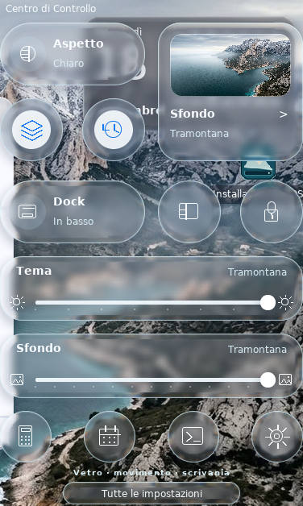

# tinymacOS 10.1.2 Tramontana · build 30B3

Manutenzione input richiesta dopo il riscontro sul PC fisico: **la 2.4.5 Levante / 21B9 aveva il mouse funzionante in Recovery e solo verticale al login; la 10.1.1 non funziona in nessuno dei due ambienti**. La 21B9 è il riferimento indicato dall’utente, non una versione dedotta dal solo storico.

## Cambiamenti
- Ripristinato il routing USB2 nativo all’avvio della **21B9** sulle famiglie Intel switchable già supportate, prima dell’enumerazione. La sola presenza di EHCI non blocca più l’instradamento verso xHCI già avviato. Nessun workaround basato sul nome della scheda madre o scrittura su controller sconosciuti.
- Verifica della modalità HID anche dopo un SET_PROTOCOL riconosciuto come riuscito: una risposta GET_PROTOCOL esplicitamente Boot non viene decodificata come Report/Report ID. Conservati parser descriptor-first, assi X/Y indipendenti, pulsanti, rotella, PS/2, EHCI/UHCI e hub.
- Recovery: un AbsolutePointer firmware che continua a restituire lo stesso stato inattivo non maschera più il SimplePointer USB. Conservati fallback da trasporto diretto inattivo, tastiera italiana e titolo centrato.
- BIOS/OpenCore: aggiunto il driver ufficiale Ps2KeyboardDxe 1.0.8 per rendere disponibile la tastiera PS/2 al picker e alla selezione Recovery con R/F12, anche senza tastiere USB. Conservata la decodifica italiana diretta all’interno della Recovery.
- **Centro di Controllo completo 10.1 invariato:** vetro reale, azioni disponibili, temi e sfondi. La preview nei sorgenti è una cattura della vera ISO 10.1.2, non un mockup.



## Test e limiti
Due build indipendenti byte-identiche. Contratti ASan/UBSan con il vero codice dei driver; cinque controlli negativi dimostrano che il codice 10.1.1 fallisce i nuovi scenari di regressione. Le ricevute della matrice input BIOS/UEFI, installazione, avvio da solo HDD, ripristino locale, Recovery ottica, tastiera italiana, UI reale e 29 regressioni kernel sono in `workspace/release-10.1.2-30B3/final-qa.json` nei sorgenti.

**Non è ancora una conferma del funzionamento sul PC ASRock Q1900M/J1900.** Le correzioni e i test riproducibili non dimostrano da remoto la causa esatta del difetto fisico. Non è richiesto un altro pannello/foto F11. Safari/WebKit non incluso; nessun browser fittizio.

## Download
- `tinymacOS-10.1.2-x86_64.iso` — **225.650.688 byte**, BIOS/UEFI ottica; non immagine USB-DD ibrida.
- `SHA256SUMS.txt` — eseguire `sha256sum -c SHA256SUMS.txt` nella cartella del download.

```text
caec5d2e5680e082baeec78b39ea48f5c7f64b83b80e8c7da74a1efa8d46e5f5
```

Repository pubblico. Sorgenti sincronizzati prima degli upload; commit e verifica del download anonimo completo attestati nella ricevuta `github-release-verification.json`, aggiunta dopo la pubblicazione. Le release precedenti, compresa la 10.1.1, sono conservate senza riscriverne asset o tag. Credenziali e chiave non sono nel repository né nella ISO.

tinymacOS è un sistema sperimentale distinto da macOS Apple.
