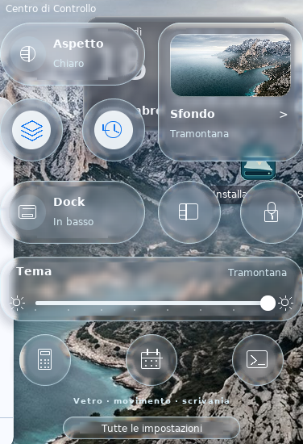

# tinymacOS 10.1.3 Tramontana · build 30B4

Nuova manutenzione dopo il riscontro fisico negativo della **10.1.2**: mouse fermo al login e piccolo movimento seguito da blocco in Recovery. I vecchi PASS QEMU non sono una conferma del funzionamento sul PC dell’utente.

## Input
- Mouse Boot HID: formato Boot standard negoziato prima di Report in nativo e Recovery; Report-ID/assi larghi conservati per i dispositivi non-Boot o il fallback confermato.
- Recovery: acquisizione del solo figlio USB Boot-mouse, senza toccare host, tastiera, hub o disco; oggetti firmware riscoperti dopo l’acquisizione.
- Recovery: movimenti relativi applicati alla posizione corrente, non a coordinate private obsolete.
- Errori USB asincroni Recovery: cancel, clear-halt se necessario e riavvio con backoff, fuori dalla callback.
- Nativo xHCI/EHCI/UHCI: il traffico valido azzera il budget di errori; gli errori intermittenti non lo esauriscono per tutta la sessione.
- Conservati PS/2, tastiera italiana, routing Intel 21B9 sui controller già supportati e driver firmware PS/2 ufficiale.

## Centro di Controllo
**Un comando per funzione:** eliminati il secondo selettore Sfondo e il secondo accesso alle Impostazioni. Pannello più compatto, vetro conservato. Sfondo con anteprima/clic e frecce, un solo selettore Tema, scorciatoie alle tre app e pulsante Impostazioni etichettato. Nessun controllo finto.



## Verifiche e limiti
Due build indipendenti identiche; ASan/UBSan, cinque controlli negativi sul vero codice 10.1.2 e test di ripresa da errori USB. Matrice input BIOS/UEFI live e HDD, installazione, ripristino locale, Recovery e 29 regressioni kernel: risultati in `final-qa.json`. Superati 27 profili input live/HDD (236 asserzioni native), 18 avvii Recovery con mouse/tablet e 29 regressioni kernel. Aggiunti 96 cicli di inversione X/Y, con 400 verifiche esatte del cursore e pausa/ripresa, divisi tra login nativo e Recovery su BIOS/UEFI + EHCI/xHCI: non basta osservare un solo spostamento.

**Non ancora provata sull’ASRock Q1900M/J1900 fisico.** Le correzioni eliminano difetti riproducibili nel codice, ma non permettono di promettere da remoto che il mouse dell’utente ora funzioni. Nessuna richiesta di un’altra foto F11. Safari/WebKit non incluso.

## Download e storico
`tinymacOS-10.1.3-x86_64.iso` (**225.650.688 byte**) e `SHA256SUMS.txt` negli asset. ISO ottica BIOS/UEFI, non immagine USB-DD ibrida. Eseguire `sha256sum -c SHA256SUMS.txt` dopo il download.

Le release precedenti sono **pre-release** su richiesta; ISO, asset e tag conservati. Sorgenti sincronizzati prima degli upload; download anonimo completo e integrità verificati nella ricevuta `github-release-verification.json` aggiunta dopo la pubblicazione.

tinymacOS è un sistema sperimentale distinto da macOS Apple.

SHA-256 ISO:
```text
07bbd324c607f3520349b940d0a7b262e276c5a078e8c39d2bce8a1c6b296ade
```
