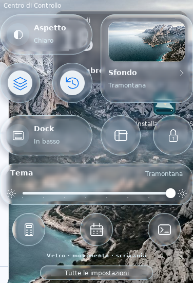

# tinymacOS 10.1.4 Tramontana · build 30B5

Manutenzione dopo il riscontro fisico della **10.1.3: Recovery si muove soltanto in verticale**. Il problema sul PC non viene considerato risolto dai precedenti PASS virtuali.

## Mouse e controller: confronto con Linux

Esaminati i driver upstream di **Linux v6.12**, con URL e SHA-256 registrati; nessun codice Linux importato. [Analisi tecnica e limiti](https://github.com/ESPNex/tinymacOS/blob/main/workspace/release-10.1.4-30B5/LINUX-REVIEW.md).

- **xHCI:** primo TRB pubblicato soltanto dopo l’intero trasferimento; evento Short Data conserva la lunghezza effettiva e attende Status; descriptor e conferma del protocollo controllati anche nella lunghezza.
- **EHCI:** overlay QH modificato solo a schedule periodica ferma; toggle interrupt mantenuto dall’hardware e conservato al riarmo, invece di invertirlo una volta per trasferimento software. Ripristino appropriato dopo clear-halt.
- **Decodifica condivisa nativo/Recovery:** descriptor e Report verificato preferiti; fallback Boot negoziato. Pacchetti numerati completi riconosciuti tramite ID e lunghezza esatti, senza confondere ID/pulsanti con X/Y. Nessuna euristica sul verso del movimento o regola per una sola scheda.
- **Riproduzione del difetto:** il medesimo frame `04 00 40 00 00 00 00` produceva **X=0/Y=64** anziché **X=64/Y=0** nel vecchio percorso Boot. Tre controlli negativi sul vero codice 10.1.3 mostrano l’errore in xHCI, USB2 e Recovery; il nuovo codice mantiene X/Y indipendenti. Quattro ulteriori controlli negativi coprono gli invarianti HCD sopra, inclusa la mancata scrittura su overlay ancora attivo.
- Conservati PS/2, sola tastiera italiana, routing Intel, acquisizione Recovery del solo figlio mouse, accumulo delle delte relative e ripresa asincrona dopo errori.

La Recovery usa il controller del firmware tramite EFI_USB_IO; non prende in carico gli HCD nativi mentre firmware/disco/tastiera li usano. Il decoder corretto è comune, ma i test dei controller nativi e quelli del percorso Recovery sono distinti.

## Centro di Controllo: icone SVG originali

**13 SVG originali**, non sprite importati né vecchie icone geometriche disegnate in C. Sorgenti realmente presenti nel filesystem in `/System/Library/CoreServices/ControlCenter/Symbols/`, con manifest.

Compilazione riproducibile in maschere alpha antialias, colorate dal renderer nativo; non si dichiara un interprete SVG/XML a runtime. Verificata la presenza delle maschere nel desktop realmente linkato e degli SVG nei due volumi della ISO.

**Vetro e comandi deduplicati conservati:** un solo Sfondo, un solo accesso alle Impostazioni. Tema, aspetto, trasparenza, movimento, Dock, Mission Control, blocco e scorciatoie rimangono funzionali.



## Verifiche e limiti

Due build indipendenti identiche. ASan/UBSan, riproduzioni X/Y e controlli negativi sul sorgente precedente, contratti UI, matrice BIOS/UEFI live/HDD, installazione e recupero locale, 29 regressioni kernel. Gate finale superato: **62 ricevute**, 27 profili input live/HDD con **236 asserzioni**, 18 avvii Recovery mouse/tablet, 29 regressioni kernel. Le prove prolungate coprono **96 cicli di inversione X/Y e 400 verifiche esatte del cursore**, divisi tra nativo e Recovery, BIOS/UEFI × EHCI/xHCI, con pausa/ripresa. Installazione BIOS, riavvio HDD, crossboot UEFI e ripristino Recovery locale senza ISO superati. `final-qa.json` vincola i risultati all’hash della ISO e dei sorgenti; non è una ricevuta di pubblicazione.

**Non verificata sull’ASRock Q1900M/J1900 fisico.** La riproduzione dimostra un difetto con quel sintomo, non che il mouse dell’utente invii necessariamente quei byte: non disponiamo della sua acquisizione USB. Non promettiamo il funzionamento fisico sulla base di QEMU e non richiediamo un’altra foto F11. Safari/WebKit non incluso.

## Download e storico

`tinymacOS-10.1.4-x86_64.iso` (**225.710.080 byte**) e `SHA256SUMS.txt` negli asset della release. **ISO ottica BIOS/UEFI, non immagine USB-DD ibrida.** La nuova ISO non aggiorna un precedente sistema installato. Sperimentare solo su dischi virtuali vuoti dedicati, non su dati importanti.

SHA-256:
```text
0a3a4b19afec5f36b6404b7422ac8a426bae4b7507290c245fd3fcb3c3c84be8
```

Le release precedenti sono **pre-release** su richiesta, conservando ISO, altri asset, note e tag. Sorgenti sincronizzati prima degli upload; lo stato di pubblicazione e la verifica anonima del download completo sono riportati in `github-release-verification.json`, aggiunto dopo la pubblicazione.

tinymacOS è un sistema sperimentale distinto da macOS Apple.
